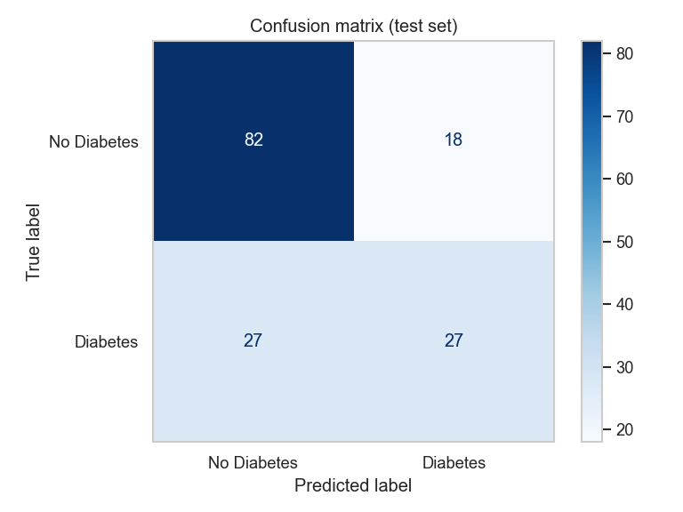
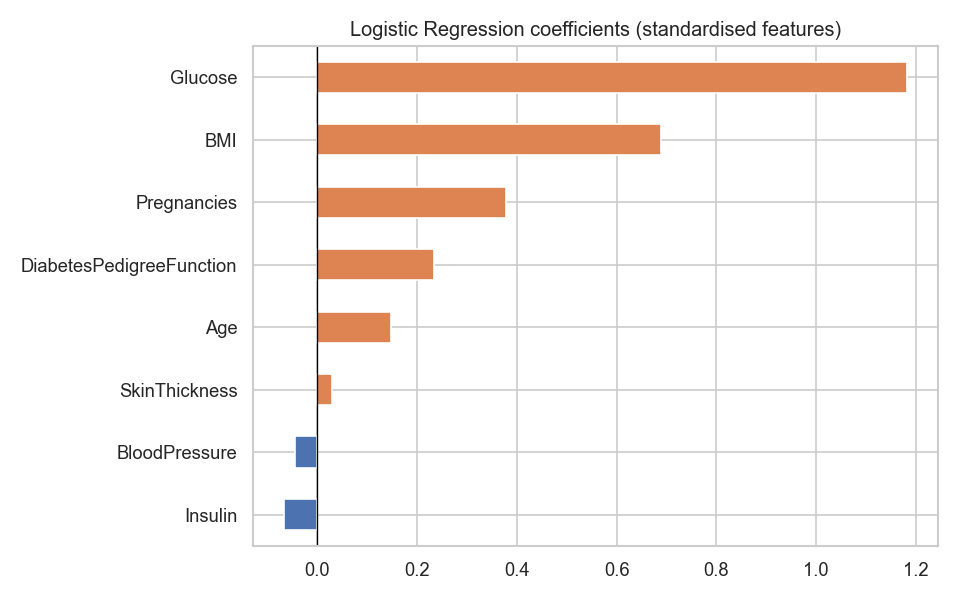

# Diabetes Prediction using Machine Learning

An end-to-end binary classification pipeline that predicts whether a patient is likely to have diabetes from routine medical measurements, built with **Python, Pandas and Scikit-learn** using **Logistic Regression**.

All code, charts and explanations are in [`Diabetes_Prediction.ipynb`](Diabetes_Prediction.ipynb).

## Dataset

`diabetes.csv`: 768 patients, 8 numeric features plus the target.

| Column | Description |
|---|---|
| Pregnancies | Number of times pregnant |
| Glucose | Plasma glucose concentration |
| BloodPressure | Diastolic blood pressure |
| SkinThickness | Triceps skin fold thickness |
| Insulin | Serum insulin level |
| BMI | Body Mass Index |
| DiabetesPedigreeFunction | Diabetes pedigree (family history) score |
| Age | Age of the patient |
| **Outcome** | **Target**: 0 = No Diabetes, 1 = Diabetes |

Class balance: 500 non-diabetic / 268 diabetic (~35% positive).

## Pipeline

1. **Data preparation**
   - Explored shape, columns, data types, missing values and summary statistics.
   - There are no NaN cells, but impossible **zeros** in Glucose, BloodPressure, SkinThickness, Insulin and BMI were treated as missing values (Insulin ~49%, SkinThickness ~30%).
   - Stratified **80/20 train-test split**: 614 training rows and 154 test rows.
   - Missing values were filled with the **median** and features were scaled with **StandardScaler**. Both were fitted on the training set only, to avoid data leakage. No categorical encoding was needed.
2. **Model building**: Logistic Regression, chosen because the target is binary, the model outputs probabilities, it is interpretable for healthcare, and it suits small tabular data.
3. **Training and evaluation**: accuracy, precision, recall, F1, confusion matrix, ROC-AUC and 5-fold cross-validation.
4. **Performance analysis**: feature importance (coefficients and odds ratios), the decision-threshold trade-off, and insights.

## Results

| Metric | Train | Test |
|---|---|---|
| Accuracy | 0.796 | 0.708 |
| Precision (Diabetes) | 0.770 | 0.600 |
| Recall (Diabetes) | 0.594 | 0.500 |
| F1-score (Diabetes) | 0.670 | 0.545 |

- **5-fold CV accuracy (train):** 0.788 ± 0.019
- **Test ROC-AUC:** 0.813
- **Confusion matrix (test):** TN 82, FP 18, FN 27, TP 27

<p float="left">
  
  
</p>

## Key insights

- **Glucose is the dominant risk factor.** Each 1-SD increase roughly triples the odds of diabetes (odds ratio ≈ 3.3). **BMI** (≈ 2.0×), **Pregnancies**, **family history** (DiabetesPedigreeFunction) and **Age** also raise risk.
- **The model generalises reasonably well.** Cross-validation accuracy (≈ 79%) matches training accuracy. The lower test score mostly reflects the variance of a small 154-row test set.
- **The main weakness is recall on diabetic patients** (0.50 at the default threshold). Lowering the threshold to 0.3 raises recall to ≈ 0.80 (missed cases drop from 27 to 11) at a small cost in precision. That is a good trade-off for a **screening** tool, where a missed case costs more than a follow-up test.
- **Limitations:** a small, single-population dataset (Pima Indian women aged 21+) and heavy missingness in Insulin and SkinThickness.
- **Next steps:** `class_weight="balanced"`, threshold tuning on a validation set, and comparing tree-based models.

## How to run

```bash
git clone https://github.com/rajnsingh99/diabetes-prediction-ml.git
cd diabetes-prediction-ml
pip install -r requirements.txt
jupyter notebook Diabetes_Prediction.ipynb
```

## Project structure

```
├── Diabetes_Prediction.ipynb   # full analysis (executed, with outputs)
├── diabetes.csv                # dataset
├── images/                     # charts saved by the notebook
├── requirements.txt
└── README.md
```
